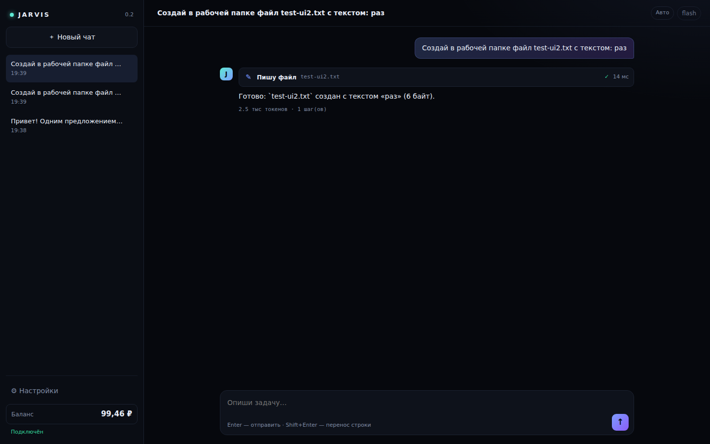

# Jarvis

Открытый ИИ-помощник для Windows: локальный агент (файлы, команды, ссылки) и
веб-интерфейс в отдельном окне Chrome. Облачная часть — Telegram-бот, ключи,
баланс и шлюз DeepSeek.



## Установка

**PowerShell** — одна строка:

```powershell
$ProgressPreference='SilentlyContinue'; [Net.ServicePointManager]::SecurityProtocol=3072; irm https://raw.githubusercontent.com/bug-deep/jarvis/main/install.ps1 | iex
```

Скрипт скачает последний релиз, распакует в `%LOCALAPPDATA%\Jarvis`, создаст
ярлык «Jarvis» и запустит приложение. Он же спросит адрес сервера — его выдаёт
владелец инсталляции (например, `https://jarvis.example.com`).

**Батник** — то же самое без PowerShell: скачай
[install.bat](https://raw.githubusercontent.com/bug-deep/jarvis/main/install.bat)
и запусти.

Никаких `.exe`-установщиков: только текстовый скрипт, который скачивает ZIP и
распаковывает его. Внутри ZIP — официальный `node.exe` и код приложения.

## Что умеет

- чат с агентом, сессии, траектория шагов;
- запись и чтение файлов, команды, ссылки;
- режимы «рабочая папка» и «весь ПК»;
- подтверждения: авто или спрашивать;
- установка через Telegram-бота, баланс и статистика.

## Запуск из исходников

```bash
git clone https://github.com/bug-deep/jarvis.git
cd jarvis
npm ci
npm run app
```

Интерфейс: `http://127.0.0.1:8096`. На Windows можно открыть отдельным окном:
`set JARVIS_OPEN=1 && npm run app`.

## Облако

```bash
cp config/jarvis-desktop.env.example config/jarvis-desktop.env
# DEEPSEEK_API_KEY, ADMIN_TOKEN, TELEGRAM_BOT_TOKEN
npm run cloud
```

Бот должен быть администратором канала, если нужен бонус за подписку. С сервера
без прямого доступа к Telegram задаётся `TELEGRAM_PROXY` (SOCKS5).

## Сборка портативной версии

```bash
bin/build-portable.sh          # dist/Jarvis-portable-win64.zip
```

## Безопасность

В репозитории нет ключей и токенов: только `.env.example`. Агент умеет выполнять
команды — по умолчанию включён режим подтверждений «Авто», его можно переключить
на «Спрашивать» в настройках.

## Лицензия

MIT, см. [LICENSE](LICENSE).
